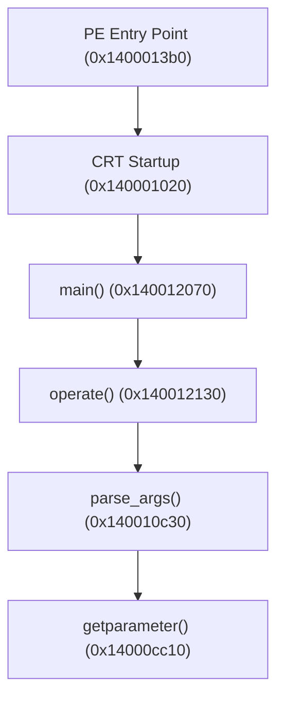

# rebuilt-curl

A lightweight, standalone CLI HTTP client implemented in modern Node.js, modeled directly on the **parameter-dispatch architecture** reverse-engineered from `curl.exe` using REA and Ghidra.

---

## 🏛️ Architecture & Lineage

During the reverse-engineering analysis of `curl.exe` (PE64 x86_64, MinGW-w64/UCRT build), the argument-handling blueprint was traced from the PE entry point down to the option dispatch loop:



### Core Blueprint Principles Incorporated

1. **Option Termination (`--`)**:
   - In `curl.exe` (`FUN_140010c30`), encountering bare double-dash `"--"` clears the option-processing flag `bVar11`. All remaining command-line tokens are treated strictly as positional non-options.
   - `rebuilt-curl` incorporates this exact behavior (`optionsEnabled = false`).

2. **Implicit `--url` Dispatch**:
   - Any token that is not a flag (or any token after `"--"`) is implicitly dispatched through the URL setter (`FUN_14000cc10("--url", argv[i], ...)`).
   - In `rebuilt-curl`, positional strings are assigned directly to the request target without requiring explicit `--url` flags.

3. **Lookahead Consumption & Exact Error Semantics**:
   - Options requiring arguments (`-X`, `-H`, `-o`, `--url`, `-d`) inspect the lookahead token `argv[i + 1]`.
   - Missing arguments trigger `rebuilt-curl: option <opt>: requires parameter`.
   - Unrecognized flags trigger `rebuilt-curl: option <opt>: is unknown` followed by the help hint.

4. **Zero External CLI Frameworks**:
   - Zero-dependency implementation using modern native Node.js APIs (`node:perf_hooks`, `node:fs`, standard `fetch`).

---

## ✨ Custom Enhancements

1. **Colorized HTTP Status & Execution Duration**:
   - Outputs HTTP status code and text with color-coded badges (Green for `2xx`, Cyan for `3xx`, Yellow for `4xx`, Red for `5xx`).
   - Measures and displays exact request duration in milliseconds (e.g. `[142.3ms]`).
   - Status output is written to `stderr` to keep `stdout` pipe-friendly.

2. **Automatic JSON Detection & Pretty-Printing**:
   - When the response headers indicate JSON (`application/json`) or the body begins with a JSON object/array token, it automatically formats and pretty-prints the JSON structure with syntax-highlighted keys and values.

---

## 🚀 Installation & Usage

### Direct Invocation

```bash
# Display help and usage
node ./index.js --help

# Basic GET request (implicit URL dispatch)
node ./index.js https://httpbin.org/get

# Explicit URL flag with custom method
node ./index.js --url https://httpbin.org/post -X POST -d "param1=value1"

# Custom headers
node ./index.js https://httpbin.org/headers -H "Authorization: Bearer token123" -H "X-Custom: demo"

# Save response to file
node ./index.js https://httpbin.org/json -o response.json

# Verbose output
node ./index.js https://httpbin.org/uuid -v

# Positional URL after '--' option terminator
node ./index.js -X GET -- https://httpbin.org/ip
```

---

## 📋 Flag Matrix

| Flag | Long Flag | Description |
|---|---|---|
| `-X <method>` | `--method`, `--request` | HTTP method (GET, POST, PUT, DELETE, etc.) |
| `-H <header>` | `--header` | Custom HTTP request header (`Name: Value`) |
| `-o <file>` | `--output` | Write response body to file |
| `-d <data>` | `--data` | Request body data (defaults method to POST) |
| `-v` | `--verbose` | Print outgoing and incoming headers |
| `-h` | `--help` | Display usage information |
| `--` | | Stop parsing options; treat remainder as URLs |
